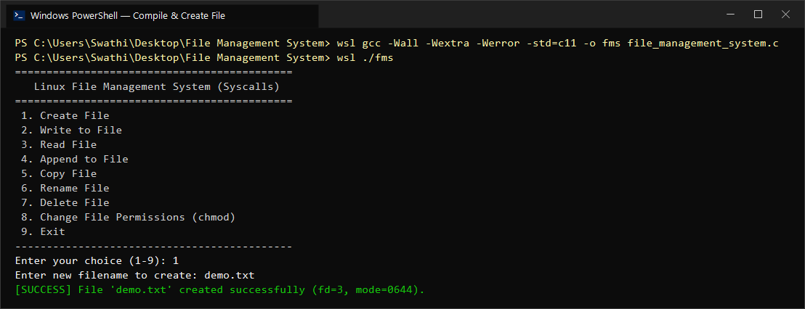
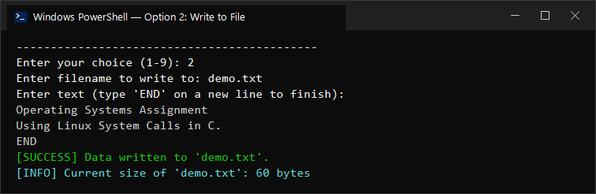
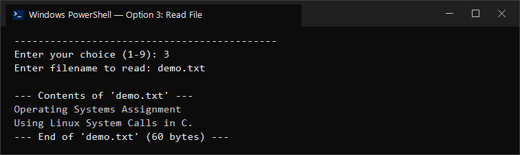
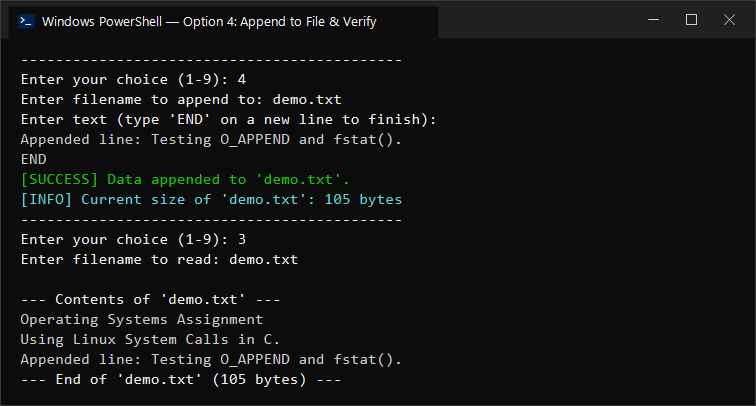
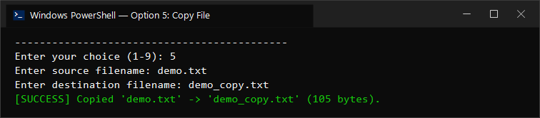
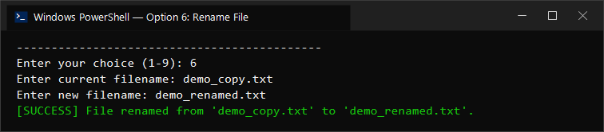
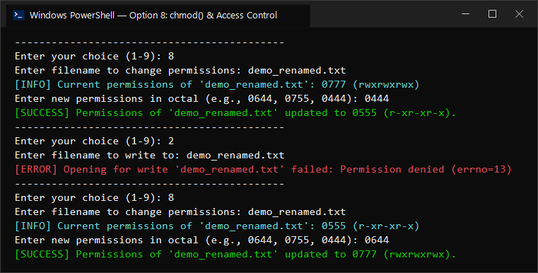
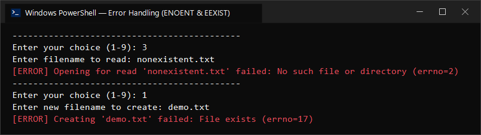
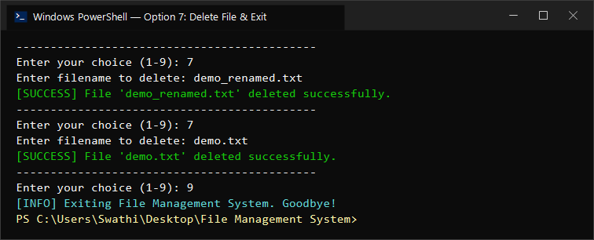

# Assignment: Design and Implementation of a File Management System Using C

**GitHub Repository:** [https://github.com/Sriram-Nambiar/File-Management-System-](https://github.com/Sriram-Nambiar/File-Management-System-)  
**Source Code:** [file_management_system.c](./file_management_system.c)  
**PDF Report:** [ASSIGNMENT_REPORT.pdf](./ASSIGNMENT_REPORT.pdf)  

---

## Part A: C Programming Implementation

### 1. System Architecture & Menu Flow

The program implements a menu-driven File Management System in C (`-std=c11`) using POSIX/Linux system calls and a `switch-case` control loop. Executed from Windows 11 PowerShell via WSL2 (Ubuntu), all file operations interact directly with the Linux kernel through file descriptors (`int fd`) rather than buffered `FILE*` streams (`fopen`/`fread`/`fwrite`).

```
+-------------------------------------------------------------------+
|                     User-Space C Program (./fms)                  |
|   Menu (switch-case): 1.Create 2.Write 3.Read 4.Append 5.Copy     |
|                       6.Rename 7.Delete 8.chmod 9.Exit            |
+---------------------------------+---------------------------------+
                                  | System Call Interface (glibc)
                                  v
+-------------------------------------------------------------------+
|                  Linux Kernel — Virtual File System (VFS)         |
|  open() | read() | write() | close() | unlink() | rename() |      |
|  fstat() | stat() | chmod()                                       |
+---------------------------------+---------------------------------+
                                  |
                                  v
+-------------------------------------------------------------------+
|             Filesystem Driver & Block Storage                     |
|     Inodes  |  Directory Entries (dentries)  |  Data Blocks       |
+-------------------------------------------------------------------+
```

### 2. Explanation of Linux System Calls Used

| System Call | Header | Signature / Usage in Program | Purpose |
| :--- | :--- | :--- | :--- |
| `open()` | `<fcntl.h>` | `open(filename, flags, mode)` | Opens an existing file or creates a new file and returns a non-negative integer **file descriptor** (`fd`). Flags used: `O_CREAT \| O_EXCL \| O_WRONLY` (create strictly new file), `O_WRONLY \| O_TRUNC` (overwrite), `O_RDONLY` (read), `O_WRONLY \| O_APPEND` (append). |
| `read()` | `<unistd.h>` | `read(fd, buffer, count)` | Reads up to `count` bytes from `fd` into `buffer`. Returns number of bytes read, `0` on EOF, or `-1` on error. |
| `write()` | `<unistd.h>` | `write(fd, buffer, count)` | Writes up to `count` bytes from `buffer` to `fd`. Wrapped in `write_all()` to handle partial writes and `EINTR` interruptions safely. |
| `close()` | `<unistd.h>` | `close(fd)` | Releases the file descriptor in the process's file descriptor table so kernel resources are freed and descriptors can be reused. |
| `unlink()` | `<unistd.h>` | `unlink(filename)` | Removes the directory entry for `filename` and decrements the inode's hard-link count; frees inode and data blocks once link count reaches `0` and all open descriptors close. |
| `rename()` | `<stdio.h>` | `rename(old_name, new_name)` | Atomically renames (or moves within the same filesystem) a directory entry without copying file data blocks. |
| `fstat()` | `<sys/stat.h>` | `fstat(fd, &st)` | Retrieves file metadata (`struct stat`) for an already-open file descriptor `fd`, including `st.st_size` (used after write/append) and `st.st_mode`. |
| `stat()` | `<sys/stat.h>` | `stat(filename, &st)` | Retrieves file metadata by path; used to verify existence, display permissions before/after `chmod()`, and prevent self-copy overwrite (`st_dev` / `st_ino` check). |
| `chmod()` | `<sys/stat.h>` | `chmod(filename, mode)` | Updates the permission bits (`st_mode`) of the file's inode using an octal mode (e.g., `0644`, `0444`, `0755`). |

---

### 3. Compilation and Execution (Windows PowerShell + WSL2)

Compiled with GCC 15.2.0 inside Windows PowerShell via WSL (`-Wall -Wextra -Werror -std=c11`):

```powershell
PS C:\Users\Swathi\Desktop\File Management System> wsl gcc -Wall -Wextra -Werror -std=c11 -o fms file_management_system.c
PS C:\Users\Swathi\Desktop\File Management System> wsl ./fms
```

### 4. Sample Input, Output & Cropped Screenshots (Operation by Operation)

#### Operation 1: Compile & Create File (`open(O_CREAT | O_EXCL)`)
```text
Enter your choice (1-9): 1
Enter new filename to create: demo.txt
[SUCCESS] File 'demo.txt' created successfully (fd=3, mode=0644).
```


#### Operation 2: Write to File (`open(O_WRONLY | O_TRUNC)`, `write()`, `fstat()`)
```text
Enter your choice (1-9): 2
Enter filename to write to: demo.txt
Enter text (type 'END' on a new line to finish):
Operating Systems Assignment
Using Linux System Calls in C.
END
[SUCCESS] Data written to 'demo.txt'.
[INFO] Current size of 'demo.txt': 60 bytes
```


#### Operation 3: Read File (`open(O_RDONLY)`, `read()`, `write(STDOUT_FILENO)`)
```text
Enter your choice (1-9): 3
Enter filename to read: demo.txt

--- Contents of 'demo.txt' ---
Operating Systems Assignment
Using Linux System Calls in C.
--- End of 'demo.txt' (60 bytes) ---
```


#### Operation 4: Append to File & Verify (`open(O_WRONLY | O_APPEND)`, `fstat()`)
```text
Enter your choice (1-9): 4
Enter filename to append to: demo.txt
Enter text (type 'END' on a new line to finish):
Appended line: Testing O_APPEND and fstat().
END
[SUCCESS] Data appended to 'demo.txt'.
[INFO] Current size of 'demo.txt': 105 bytes
```


#### Operation 5: Copy File (`read()` / `write()` Buffered Loop)
```text
Enter your choice (1-9): 5
Enter source filename: demo.txt
Enter destination filename: demo_copy.txt
[SUCCESS] Copied 'demo.txt' -> 'demo_copy.txt' (105 bytes).
```


#### Operation 6: Rename File (`rename()`)
```text
Enter your choice (1-9): 6
Enter current filename: demo_copy.txt
Enter new filename: demo_renamed.txt
[SUCCESS] File renamed from 'demo_copy.txt' to 'demo_renamed.txt'.
```


#### Operation 8: Change File Permissions (`chmod()`) & Access Control (`EACCES`)
```text
Enter your choice (1-9): 8
Enter filename to change permissions: demo_renamed.txt
[INFO] Current permissions of 'demo_renamed.txt': 0777 (rwxrwxrwx)
Enter new permissions in octal (e.g., 0644, 0755, 0444): 0444
[SUCCESS] Permissions of 'demo_renamed.txt' updated to 0555 (r-xr-xr-x).

Enter your choice (1-9): 2
Enter filename to write to: demo_renamed.txt
[ERROR] Opening for write 'demo_renamed.txt' failed: Permission denied (errno=13)

Enter your choice (1-9): 8
Enter filename to change permissions: demo_renamed.txt
[INFO] Current permissions of 'demo_renamed.txt': 0555 (r-xr-xr-x)
Enter new permissions in octal (e.g., 0644, 0755, 0444): 0644
[SUCCESS] Permissions of 'demo_renamed.txt' updated to 0777 (rwxrwxrwx).
```


#### Error Handling: Non-Existent (`ENOENT`) & Duplicate File (`EEXIST`)
```text
Enter your choice (1-9): 3
Enter filename to read: nonexistent.txt
[ERROR] Opening for read 'nonexistent.txt' failed: No such file or directory (errno=2)

Enter your choice (1-9): 1
Enter new filename to create: demo.txt
[ERROR] Creating 'demo.txt' failed: File exists (errno=17)
```


#### Operation 7 & 9: Delete File (`unlink()`) & Exit
```text
Enter your choice (1-9): 7
Enter filename to delete: demo_renamed.txt
[SUCCESS] File 'demo_renamed.txt' deleted successfully.

Enter your choice (1-9): 7
Enter filename to delete: demo.txt
[SUCCESS] File 'demo.txt' deleted successfully.

Enter your choice (1-9): 9
[INFO] Exiting File Management System. Goodbye!
```


---

## Part B: Conceptual Analysis

### 1. How the Operating System Manages File Creation, Reading, Writing, and Deletion

Modern Operating Systems (such as Linux via its **Virtual File System (VFS)**) separate **file metadata** (stored in an **inode**), **human-readable names** (stored in **directory entries / dentries**), and **open session state** (tracked in kernel tables).

```
Process Space          Kernel Tables                        Disk Structures
+-------------+       +--------------------+               +-----------------+
| FD Table    |       | System Open-File   |               | Inode Table     |
| 0: stdin    |       | Table              |               | [inode #412]    |
| 1: stdout   |       | - file offset (pos)| ------------> | mode, uid, size |
| 2: stderr   |       | - access flags     |               | block pointers  |
| 3: demo.txt | ----> | - inode pointer    |               +--------+--------+
+-------------+       +--------------------+                        |
                                                                    v
+--------------------+                                     +-----------------+
| Directory Entry    | ----------------------------------> | Data Blocks     |
| "demo.txt" -> #412 |                                     | [blk 88][blk 89]|
+--------------------+                                     +-----------------+
```

1. **File Creation (`open(..., O_CREAT, mode)`):**
   - The kernel traverses the parent directory path and verifies write (`w`) and search/execute (`x`) permissions on the parent directory.
   - It allocates a free **inode** from the filesystem's inode bitmap and initializes metadata (owner UID/GID, permissions masked with `umask`, timestamps, size = `0`, link count = `1`).
   - It inserts a new **directory entry** mapping the filename to the allocated inode number.
   - It creates an entry in the **system-wide open-file table** (offset = `0`, mode flags) and returns the lowest unused index in the **per-process file descriptor table** (`fd`).
2. **Reading (`read(fd, buf, count)`):**
   - The kernel validates `fd` and checks that it was opened with read access (`O_RDONLY` or `O_RDWR`).
   - Using the current **file offset** in the open-file table, it locates the target logical block and translates it via the inode's block pointers (or extent tree) to physical disk blocks.
   - If the block is already in the kernel **page cache / buffer cache**, data is copied directly from RAM to user space (`buf`); otherwise, the disk driver fetches the block into the page cache first.
   - The file offset advances by the number of bytes actually read.
3. **Writing (`write(fd, buf, count)`):**
   - The kernel verifies write permission on the open descriptor (`O_WRONLY` or `O_RDWR`).
   - If `O_APPEND` is set, the kernel atomically sets the file offset to the current file size before writing.
   - If the write extends past allocated blocks, the filesystem allocates free blocks from the free-space manager and updates the inode's block pointers/extents.
   - Data is copied into the **page cache** (marked dirty for asynchronous writeback unless `fsync()`/`O_SYNC` is used), and the inode's `st_size` and `mtime`/`ctime` are updated.
4. **Deletion (`unlink(path)`):**
   - The kernel checks write and execute permission on the parent directory and removes the directory entry `"filename" -> inode`.
   - The inode's **hard-link count (`st_nlink`)** is decremented by `1`.
   - Only when `st_nlink == 0` **and** no process still holds an open file descriptor referencing that inode does the kernel deallocate the inode and return all of its data blocks to the free-space pool.

---

### 2. File Attributes Maintained by the Operating System

In Linux/POSIX systems, file attributes are stored inside the **inode** (exposed via `struct stat`) rather than inside the filename entry itself:

| Attribute | `struct stat` Field | Purpose |
| :--- | :--- | :--- |
| **File Identifier** | `st_ino`, `st_dev` | Unique inode number within a filesystem (`st_dev`) used by the kernel to uniquely identify the file regardless of hard links or renames. |
| **File Type** | `st_mode` (type bits) | Distinguishes regular files, directories, symbolic links, FIFOs, sockets, and block/character devices. |
| **Protection / Permissions** | `st_mode` (low 12 bits) | Controls read (`r`), write (`w`), execute (`x`) rights for owner, group, and others, plus special bits (`SUID`, `SGID`, `sticky`). |
| **Ownership** | `st_uid`, `st_gid` | Numeric User ID of the owner and Group ID associated with the file for authorization checks. |
| **File Size** | `st_size` | Logical length of the file in bytes (critical for EOF detection, `O_APPEND`, and reporting). |
| **Storage Allocation** | `st_blocks`, `st_blksize` | Physical 512-byte blocks allocated on disk and preferred I/O block size for efficient transfers. |
| **Link Count** | `st_nlink` | Number of directory entries (hard links) pointing to this inode; prevents premature reclamation until it reaches `0`. |
| **Timestamps** | `st_atim`, `st_mtim`, `st_ctim` | `atime` (last data access), `mtime` (last content modification), and `ctime` (last metadata/inode change) for auditing, backups, and build tools. |
| **Location Pointers** | (Internal inode extents/pointers) | Maps logical file offsets to physical disk block addresses. |

---

### 3. Comparison of Contiguous, Linked, and Indexed File Allocation Methods

```
Contiguous Allocation          Linked Allocation              Indexed Allocation
Directory: [start=2, len=3]    Directory: [start=2, end=7]    Directory: [index_blk=5]
+---+---+---+---+---+---+      +---+---+---+---+---+---+      Index Block #5: [2, 6, 9]
|   |   | A | A | A |   |      |   |   |A->6|  |   |   |      +---+---+---+---+---+---+
+---+---+---+---+---+---+      +---+---+---+---+---+---+      |   |   | A |   |   |idx|
  0   1   2   3   4   5          0   1   2   3   4   5          0   1   2   3   4   5
                                         +-->6->7(EOF)                  |       |
                                                                      +-+-------+->6, 9
```

| Criterion | Contiguous Allocation | Linked Allocation | Indexed Allocation |
| :--- | :--- | :--- | :--- |
| **Block Placement** | File occupies consecutive disk blocks (`start`, `length`). | Blocks can be anywhere; each block holds a pointer to the next block. | All block pointers are gathered into an **index block** (or multi-level / extent tree). |
| **Sequential Access** | **Fastest** — minimal disk head seek latency. | **Moderate** — must follow pointers block-by-block across disk. | **Fast** — index block is cached in memory; blocks read directly. |
| **Random (Direct) Access** | **O(1)** — `block = start + offset / block_size`. | **Poor O(n)** — must traverse `n` pointers from the start (unless cached in FAT). | **O(1)** — direct lookup in index block (`index[offset / block_size]`). |
| **External Fragmentation** | **High** — free space breaks into small gaps; compaction needed. | **None** — any free block can satisfy a request. | **None** — any free block can be allocated. |
| **Internal Fragmentation** | Only in the last block (plus unused pre-allocated growth space). | Pointer overhead (~4–8 bytes) inside every data block. | Index block overhead even for very small files (unless inline/extents are used). |
| **File Size Growth** | **Difficult** — may require relocating the entire file if adjacent blocks are occupied. | **Easy** — append any free block and update the tail pointer. | **Easy** — allocate free block and add pointer to index block (multi-level for huge files). |
| **Reliability / Fault Tolerance** | High — no per-block pointers to corrupt. | **Low** — a single corrupted pointer breaks the rest of the chain. | Moderate/High — damage isolated if index block is replicated or journaled. |

---

### 4. Free Disk Space Management: Bitmap vs. Linked-List Techniques

#### A. Bitmap (Bit Vector)
A contiguous array of bits represents all blocks on the disk (`0` = allocated, `1` = free, or vice versa):
```
Block #:  0   1   2   3   4   5   6   7   8   9
Bitmap: [ 0 | 0 | 1 | 1 | 0 | 1 | 0 | 0 | 1 | 1 ]   (1 = Free, 0 = Used)
```
- **How it works:** To find a free block, the OS scans words in memory using fast CPU bit-scan instructions (e.g., find first set bit). Finding `k` contiguous free blocks requires scanning for `k` consecutive `1` bits.
- **Advantages:** Simple and fast to find contiguous free regions; compact (for a 1 TB disk with 4 KB blocks, the bitmap is `2^40 / 2^12 / 8 = 32 MB`).
- **Disadvantages:** Keeping the entire bitmap in RAM consumes memory proportional to disk size; updating bits requires careful synchronization and disk persistence.

#### B. Linked-List (Free List)
All free blocks are chained together using pointers stored inside the free blocks themselves, with only a single **head pointer** kept in the superblock/RAM:
```
Superblock Free Head ---> [Free Blk 2 | next=3] ---> [Free Blk 3 | next=5] ---> [Free Blk 5 | next=NULL]
```
- **How it works:** Allocation pops the head block and sets `head = block.next`. Deallocation prepends the freed block to the head.
- **Advantages:** Zero extra space overhead on disk (uses the unused data space inside free blocks).
- **Disadvantages:** Traversing the list to find multiple or contiguous blocks requires extra disk I/O.
- **Optimizations:**
  - **Grouping:** Store addresses of `N` free blocks in the first free block, where the `N`-th address points to another block holding `N` more free addresses.
  - **Counting:** Store `(first_free_block, count_of_contiguous_free_blocks)` pairs, dramatically shrinking metadata when large contiguous runs exist.

---

### 5. How File Permissions Prevent Unauthorized Access

Linux enforces **Discretionary Access Control (DAC)** on every inode via a 9-bit permission matrix (`rwx` for **User/Owner**, **Group**, and **Others**), plus 3 special bits (`SUID`, `SGID`, `Sticky`):

```
Octal 0644  =>  Owner: rw- (6)  |  Group: r-- (4)  |  Others: r-- (4)
Octal 0444  =>  Owner: r-- (4)  |  Group: r-- (4)  |  Others: r-- (4)
Octal 0755  =>  Owner: rwx (7)  |  Group: r-x (5)  |  Others: r-x (5)
```

- **Kernel Enforcement Flow:** When a process calls `open()`, `read()`, `write()`, or `execve()`, the kernel compares the process's **effective UID/GID (`euid`/`egid`)** against the file inode's `st_uid` and `st_gid`:
  1. If `euid == 0` (root), access is typically granted.
  2. Else if `euid == st_uid`, **only the Owner bits** are evaluated (even if Group/Others have broader rights).
  3. Else if `egid == st_gid` or in supplementary groups, **Group bits** are evaluated.
  4. Otherwise, **Others bits** are evaluated.
- **Prevention of Unauthorized Access:**
  - Read (`r`) blocks unauthorized reading (`open(..., O_RDONLY)` fails with `EACCES`).
  - Write (`w`) blocks unauthorized modification or truncation (demonstrated in Operation 8: setting read-only `0444` caused `open(..., O_WRONLY | O_TRUNC)` to fail with `Permission denied (errno=13)`).
  - Execute (`x`) on files prevents unauthorized execution; on directories, `x` prevents path traversal into subdirectories.
  - **Default Safety (`umask`):** New files created with `0666` or `0644` have `umask` (commonly `0022`) masked out (`mode & ~umask`), preventing accidental world-writable files.

---

## Part C: Application and Analysis

### 1. Displaying File Size After Writing or Appending Data

The program uses the `fstat()` system call on the open file descriptor `fd` immediately after `write_user_text_to_fd()` succeeds in both `write_to_file()` (Option 2) and `append_to_file()` (Option 4):

```c
static void display_file_size(int fd, const char *filename) {
    struct stat st;
    if (fstat(fd, &st) == -1) {
        print_sys_error("Checking size of", filename);
        return;
    }
    printf("[INFO] Current size of '%s': %lld bytes\n",
           filename, (long long)st.st_size);
}
```

- **Why `fstat(fd, &st)`?** It reads the authoritative byte count (`st.st_size`) directly from the kernel's in-memory inode for the open descriptor without needing an extra path lookup (`stat`) or modifying the file offset (`lseek`).
- **Verified Execution Result:**
  - After writing 2 lines to `demo.txt`: `[INFO] Current size of 'demo.txt': 60 bytes`
  - After appending 1 line to `demo.txt`: `[INFO] Current size of 'demo.txt': 105 bytes`

### 2. Implementing File Permission Changes Using `chmod()`

Option 8 (`change_permissions()`) uses `stat()` and `chmod()` from `<sys/stat.h>`:
1. Calls `stat(filename, &st)` to verify the target exists and prints current octal and symbolic permissions.
2. Reads an octal permission string from the user and strictly validates it with `strtol(mode_str, &endptr, 8)` (rejecting non-octal characters or out-of-range values outside `0`–`07777`).
3. Calls `chmod(filename, (mode_t)parsed_mode)` and re-checks with `stat()` to confirm the updated permissions.
- **Verified Execution Result:**
  - Setting `0444` updated `demo_renamed.txt` to read-only (`0555 (r-xr-xr-x)` on WSL/NTFS DrvFs), and a subsequent write attempt failed with `Permission denied (errno=13)`.
  - Restoring `0644` made the file writable again (`0777 (rwxrwxrwx)`).

### 3. Error Handling When a File Does Not Exist or Cannot Be Accessed

Every system call (`open`, `read`, `write`, `close`, `unlink`, `rename`, `stat`, `fstat`, `chmod`) is checked against its error return value (`-1`):
- **Global `errno` + `strerror(errno)`:** Upon failure, `print_sys_error()` flushes `stdout` and writes a diagnostic to `stderr` showing the failed action, target filename, human-readable reason via `strerror(errno)`, and numeric `errno`:
  - **Missing file (`ENOENT`, `errno=2`):** Attempting to read, write, append, copy, rename, delete, or `chmod` a non-existent file immediately reports `[ERROR] ... failed: No such file or directory (errno=2)`. In `write_to_file()` and `append_to_file()`, `open()` is checked *before* prompting for text so users never type input for an inaccessible file.
  - **Permission denied (`EACCES`, `errno=13`):** Opening a read-only file for writing/appending or modifying a protected directory fails cleanly with `Permission denied (errno=13)` without crashing.
  - **Duplicate creation (`EEXIST`, `errno=17`):** `create_file()` passes `O_CREAT | O_EXCL` so creating an already-existing file fails safely instead of silently truncating existing data.
  - **Directory / Self-Copy Guards:** `read_file()` and `copy_file()` inspect `S_ISDIR(st.st_mode)` to reject directories cleanly; `copy_file()` also compares `(st_dev, st_ino)` between source and destination so copying a file onto itself cannot truncate the source before reading.
  - **Partial Writes & Signal Interruptions (`EINTR`):** `write_all()` loops until all bytes are written or a non-`EINTR` error occurs.

### 4. Limitations and Suggested Improvements

| Limitation | Impact | Suggested Improvement |
| :--- | :--- | :--- |
| **No Directory Management** | Operates only on files; cannot create (`mkdir()`), list (`opendir()`/`readdir()`), navigate (`chdir()`), or remove (`rmdir()`) directories. | Add menu options for `ls`, `mkdir`, `rmdir`, and `cd` using POSIX directory system calls. |
| **Fixed-Size Path & Line Buffers** | `MAX_PATH_LEN` (`256`) and `LINE_BUF_SIZE` (`1024`) truncate or reject longer paths/lines. | Use `PATH_MAX` or dynamic allocation (`getline()` / `realpath()`). |
| **Text-Sentinel Input (`END`)** | Typing a line consisting strictly of `END` terminates input prematurely; binary files cannot be entered interactively. | Support binary/hex input or EOF-reset handling (`clearerr(stdin)` on TTY) or command-line arguments. |
| **No File Locking / Concurrency Control** | Simultaneous instances writing or appending to the same file can interleave or race during `copy_file()`/`rename()`. | Use advisory or mandatory locking via `flock()` or `fcntl(fd, F_SETLK, ...)`. |
| **No Confirmation on Destructive Operations** | `unlink()`, `O_TRUNC` overwrite, and `rename()` overwrite execute immediately without prompting. | Add a `[y/N]` confirmation prompt before deleting, truncating, or overwriting an existing destination. |
| **No Extended Metadata / ACLs / Symlink Handling** | `copy_file()` preserves basic `0777` mode bits only; timestamps, ownership, ACLs, and symlinks (`lstat()`) are not explicitly handled. | Use `futimens()` to preserve timestamps, `lstat()`/`readlink()` for symbolic links, and `chown()` when privileged. |
| **Interactive-Only Interface** | Cannot be scripted cleanly with command-line flags (e.g., `./fms --read demo.txt`). | Support `getopt()` CLI flags alongside the interactive menu. |
